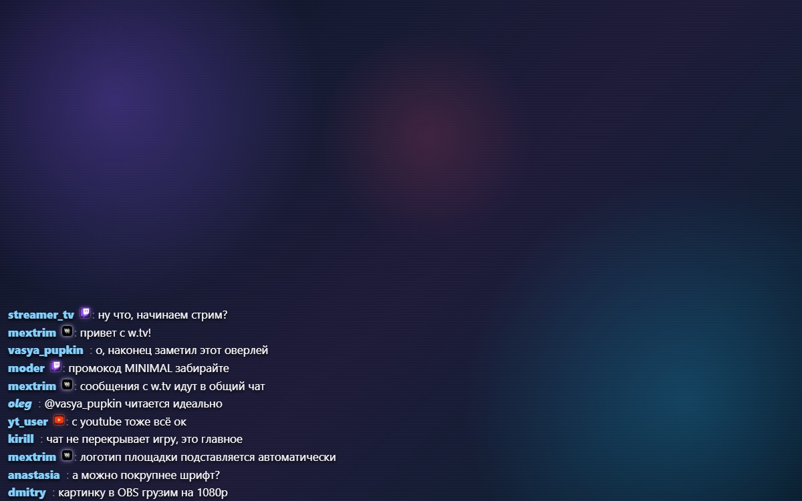

# minimal-chat

[](https://github.com/Mextrim/rutonychat-minimal-chat/releases)
[](LICENSE)
[](https://store.steampowered.com/app/524660/)

Минималистичная тема чата для [RutonyChat](https://store.steampowered.com/app/524660/).

Никаких карточек, подложек и рамок. Только текст с мягкой тенью.
Чат не перекрывает игру и не закрывает HUD.



> Изображение — рендер темы на синтетическом фоне, не скриншот игры.

---

## Зачем

Карточка с фоном и рамкой занимает около **44 пикселей** на строку. Строка
`minimal-chat` — около **25 пикселей**, и она полностью прозрачная. На стриме
это принципиально: видно игру, чат не отвлекает.

Цена — читаемость держится на тени, а не на подложке.

---

## Установка

**[⬇ Скачать minimal-chat-1.0.0.zip](https://github.com/Mextrim/rutonychat-minimal-chat/releases/download/v1.0.0/minimal-chat-1.0.0.zip)** ·
[все релизы](https://github.com/Mextrim/rutonychat-minimal-chat/releases)

### 1. Распакуйте архив

Внутри папка `minimal-chat/` — её и нужно перенести в игру.

### 2. Скопируйте папку в темы RutonyChat

По умолчанию Steam ставится сюда:

```
C:\Program Files (x86)\Steam\steamapps\common\RutonyChat\themes\minimal-chat\
```

Если библиотека лежит на другом диске (например, на `D:`), ищите
`steamapps\common\RutonyChat\themes\` внутри неё. Итог должно получиться так:

```
<RutonyChat>/themes/minimal-chat/
├── template.html
├── chat.css
├── params.json
└── images/
    └── wtv.png
```

> Копируйте **всю папку** `minimal-chat`, а не её содержимое. Иначе игра
> не найдёт тему.

### 3. Перезапустите RutonyChat

RutonyChat читает список тем при запуске. Новая папка без перезапуска
в списке не появится.

Запускайте игру **только из Steam** — при прямом запуске `.exe` приложение
отказывается работать и сразу завершается.

### 4. Примените тему

**Настройки → Темы → Minimal Chat → Применить**.

Тема заработает сразу, настройки можно менять позже.

### Для OBS

1. В RutonyChat откройте окно со ссылкой для OBS и скопируйте её оттуда
2. В OBS: **Источники → + → Браузер**
3. Вставьте скопированную ссылку в поле URL

Ссылку нужно брать из приложения: путь к странице чата задаёт сам RutonyChat,
и он меняется при переносе библиотеки Steam или смене порта в настройках.

Если страница осталась белой — обновите источник в OBS
(правый клик по источнику → «Обновить»): OBS кэширует файлы темы
и после перезапуска игры показывает старую версию.

---

## Параметры

Все настраиваются в настройках темы.

| Параметр | По умолчанию | Описание |
|---|---|---|
| `NicknameColor` | `#7FD3FF` | Цвет никнейма |
| `TextColor` | `#FFFFFF` | Цвет текста |
| `ReplyColor` | `#FFD479` | Цвет реплая |
| `LinksColor` | `#7CE7C4` | Цвет ссылок |
| `ShadowColor` | `#000000` | Цвет тени |
| **`ShadowSize`** | `3` | **Размер тени, 0–20. Главный параметр читаемости** |
| `NicknameBold` | `вкл` | Полужирный никнейм |
| `QtyMessages` | `9` | Сколько сообщений держать на экране |
| `TimeNewMessages` | `15` | Секунд до исчезновения, 2–600 |
| `HideMessages` | `вкл` | Скрывать сообщения по таймеру |
| `ShowAvatars` | **выкл** | Показывать аватары |
| `ShowSiteIcons` | `вкл` | Показывать иконки площадок |
| `FontNickname` | Segoe UI 17 | Шрифт никнейма |
| `FontText` | Segoe UI 17 | Шрифт текста |

### Про `ShadowSize`

Главный параметр темы. На светлой игре ставьте `4`–`5`, на тёмной хватит `2`–`3`.

Если текст «теряется» на фоне, или наоборот тень режет глаза на тёмной карте —
это первое, что нужно поднять или опустить. Остальное вторично.

---

## Значки площадок

Иконка определяется по имени файла, цвет — по таблице из 36 площадок:
Twitch, YouTube, VK, Kick, Trovo, W.TV и другие.

Значок 15px с цветным свечением и тонкой светлой рамкой — тёмные логотипы
не сливаются в безликое пятно.

### Поддержка W.TV

Тема распознаёт служебный маркер, который добавляет в никнейм
автономный скрипт [`rutonychat-wtv-script`](https://github.com/Mextrim/rutonychat-wtv-script),
и подставляет официальный логотип площадки вместо служебных символов.

Чужие темы маркер не снимут — они выведут его как часть ника.

---

### Если тема не появилась в списке

| Симптом | Причина |
|---|---|
| Темы нет в списке | Не перезапущена игра либо скопировано содержимое папки, а не сама папка |
| Текст не видно на светлом фоне | Поднимите `ShadowSize` до 4–5 в настройках темы |
| Значки площадок — цветные квадраты | Не загрузился `images/wtv.png`, проверьте путь |
| В OBS старая версия | Правый клик по источнику → «Обновить» |

---

## Требования

RutonyChat

---

## Лицензия

MIT — см. [LICENSE](LICENSE).

Логотип W.TV в `images/` — сторонний материал, распространяется отдельно,
подробности в [NOTICE](NOTICE).
